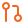

<h2 align="center">
  
    
</h2>

  <b>Lightweight Linux for single-board computers.</b> 
  Debian and Ubuntu userspace with maintained kernels, on
  <b>ARM</b>, <b>RISC-V</b>, <b>LoongArch</b> and <b>x86</b>.

  <a href="https://www.armbian.com/download/"><b>Download</b></a> &nbsp;·&nbsp;
  <a href="https://docs.armbian.com"><b>Documentation</b></a> &nbsp;·&nbsp;
  <a href="https://forum.armbian.com"><b>Forum</b></a> &nbsp;·&nbsp;
  <a href="https://github.com/armbian/build"><b>Build framework</b></a> &nbsp;·&nbsp;
  <a href="https://www.armbian.com/donate/"><b>Donate</b></a>

<!-- auto:public-status -->

  Latest stable <a href="https://docs.armbian.com/releases/26.8/"><b>26.8.3</b></a> (23 Aug 2026) &nbsp;·&nbsp;
  next <a href="https://docs.armbian.com/releases/release-model/"><b>26.11</b></a> by the end of November 2026 &nbsp;·&nbsp;
  <b>155</b> boards with standard support, <b>244</b> community

<!-- /auto:public-status -->

---

 **Server and IoT** — minimal images, with `armbian-config` for networking, storage and services

 **Desktop** — thirteen desktop environments, hardware acceleration where the SoC has it

 **Yours to change** — one script builds image, kernel and bootloader. Adding a board is a pull request, not a fork

 **Tested on real hardware** — [a rack of boards](https://docs.armbian.com/contribute/datacenter/) flashes, boots and measures every build

---

### Where things live

 **Build the OS**
- [build](https://github.com/armbian/build) — the build framework: one script makes images, kernels and bootloaders. Start here
- [configng](https://github.com/armbian/configng) — `armbian-config`, the setup and maintenance tool on every image
- [firmware](https://github.com/armbian/firmware) — firmware blobs for supported hardware
- [linux-rockchip](https://github.com/armbian/linux-rockchip) — Rockchip vendor kernel

 **Get and install**
- [imager](https://github.com/armbian/imager) — flash images to SD card, USB or eMMC
- [community](https://github.com/armbian/community) — automated builds for community-maintained boards

 **Learn**
- [documentation](https://github.com/armbian/documentation) — source of [docs.armbian.com](https://docs.armbian.com)
- [website](https://github.com/armbian/website) — armbian.com, imager.armbian.com and the public API

 **Behind the scenes**
- [ci](https://github.com/armbian/ci) — builds and publishes every image
- [armbian.github.io](https://github.com/armbian/armbian.github.io) — automation and the data behind our services
- [external](https://github.com/armbian/external) — third-party packages in the Armbian APT repository
- [cve](https://github.com/armbian/cve) — kernel security fix backports
- [sdk](https://github.com/armbian/sdk) — ready-made VM for Armbian development
